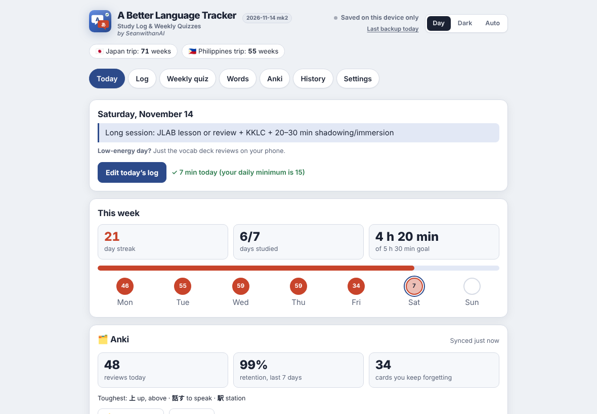
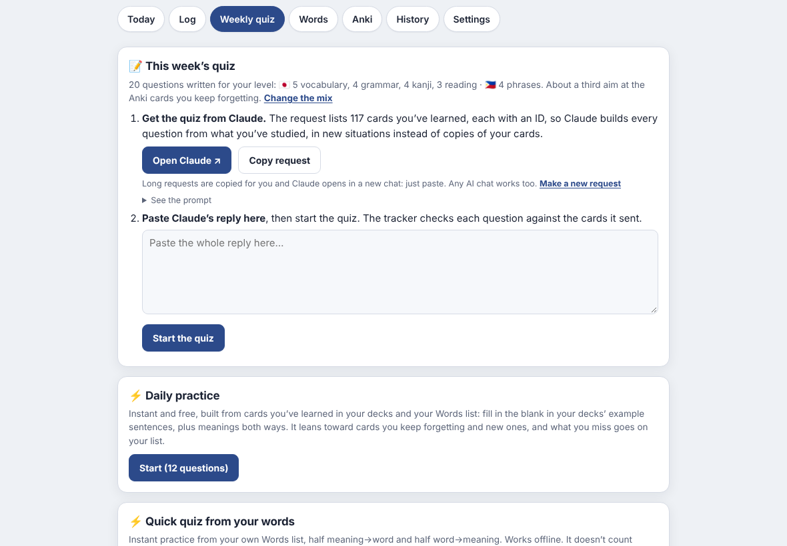

# A Better Language Tracker

A study log and weekly quiz for any language, in a single HTML file. It runs on its own in any web browser, or inside [PageVault](https://github.com/SeanwithanAI/PageVault), where each person's data is saved on your server.

**Current version: 2026-11-14 mk2** · by SeanwithanAI

  

## What it does

- **Any languages.** Start from a preset (Japanese, Korean, Mandarin, Tagalog, Spanish, French, German, Italian, Portuguese, Russian, Vietnamese, Arabic, Hindi) or add your own. Each language has its own color, flag, notes and goal date.
- **Today screen.**
  - Today's plan, plus a "low-energy day" minimum.
  - Day streak, days studied this week, and minutes against your weekly goal.
  - A dot for each day of the week. Tap a dot to edit that day.
- **Daily log.** Minutes per language, with +10/+30 buttons. Check off what you did from your own list of activities, and add a note. You can go back and edit any past day.
- **Counts and goals.**
  - Track anything: words, kanji, characters, lessons, phrases.
  - Each count can have a total and a milestone with a date. The tracker shows how many per week you need to reach the milestone, and whether you're on pace based on your own updates.
  - Counts can be taken straight from your Words list.
- **Trip or goal countdowns** for each language.
- **Words & phrases list.**
  - Each entry has a reading, meaning and note.
  - Add many at once by pasting lines like `word = meaning`.
  - Searchable.
- **Weekly quiz, written by Claude, from what you've actually learned.**
  1. The app builds a request with a sample of the cards you've learned (from your synced Anki decks and your Words list). Each card has an ID like `D1-13kw`, and the sample leans toward new cards and ones you keep forgetting.
  2. Claude is asked to use only those items, put them into new everyday situations instead of copying the cards, and tag each question with the IDs it tests.
  3. Tap **Open Claude** (long requests are copied for you), or paste the request into any AI chat.
  4. Paste the reply back. The tracker checks every question against your cards and leaves out any that use cards you haven't learned.
  5. You get a scored quiz with explanations, a skill ranking and a focus for next week. Cards you miss go on your "keep forgetting" list.

  It's free with any Claude account. No API key needed.
- **Daily practice (free, offline).** Instant questions from your learned cards: fill in the blank using your decks' example sentences, sentence meanings, and words both ways. It rotates through all your decks and leans toward cards you keep forgetting and new ones.
- **Quick quiz from your words.** Instant, offline practice from your own list. It doesn't count toward your weekly ranking.
- **Anki sync** (desktop Anki with the free [AnkiConnect](https://ankiweb.net/shared/info/2055492159) add-on, code `2055492159`):
  - Finds your decks and matches each one to a language and skill (for example Core 6k → vocabulary, JLAB → grammar, KKLC → kanji). You can change any match.
  - Keeps your counts up to date from the cards you've started or matured in each deck.
  - Logs your Anki review time and review count for each day, separately from the minutes you type.
  - Shows each deck's week: reviews, retention, time, and cards started.
  - Lists the cards you keep forgetting (forgotten 2+ times, Again in the last 2 weeks, or missed in a quiz), worst first. **Tag them in Anki** to review just those in a filtered deck. Ask Claude for memory tricks on one card or several, practice them in a quick quiz, or mark one as "got it".
  - Weekly check-in with Claude: sends your week's Anki numbers, log, quiz results and toughest cards for a review, suggested changes and memory tricks.
  - Your weekly quiz request includes your Anki stats and the cards you keep forgetting, so about a third of the questions aim at them.
  - Syncs on its own when the tracker opens on the computer with Anki, and every 10 minutes while it's open. Your phone shows the last sync.
- **History.** Quiz results by week, recent study days, and how each count has changed.
- **Charts.** Minutes per week for the last 8 weeks, stacked by language.

## Quality of life

- Day / Dark / Auto theme.
- Works on phones.
- In PageVault, data is saved to your server, separately for each person who signs in.
- Outside PageVault, data is saved in your browser, with a reminder every 7 days to download a backup.
- **Download app + data (.zip)** puts this version of the app, your backup and a short note in one zip.
- Back up and restore with a JSON file.

## Using it

- **On its own:** download `A-Better-Language-Tracker-2026-11-14-mk2.html` and open it in a browser.
- **In PageVault:** upload the HTML file as an app.

Previous versions of these apps are at https://github.com/SeanwithanAI?tab=repositories.
