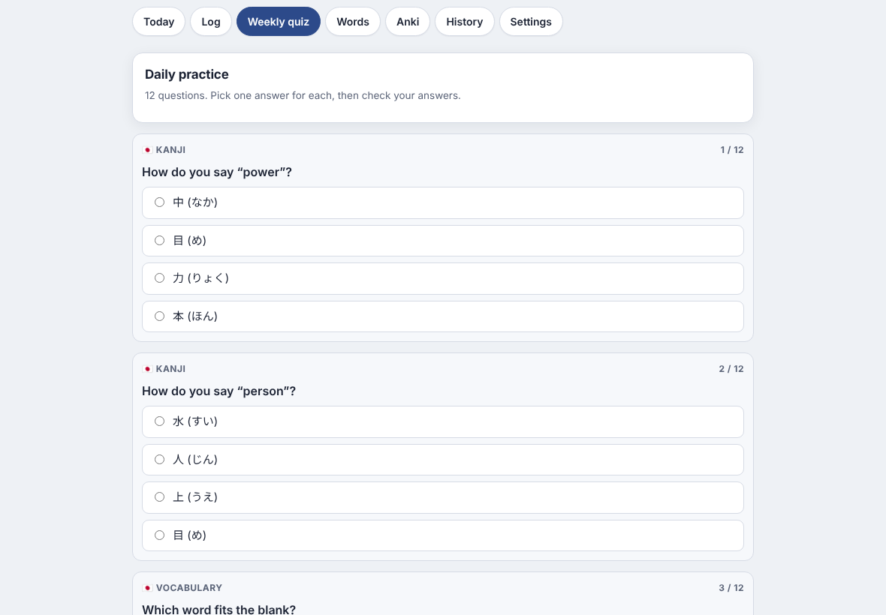

# A Better Language Tracker

**Study Log & Weekly Quizzes: track every language you're learning, sync with Anki, and get quizzed on what you actually studied**

*by SeanwithanAI*

---

## Overview

A Better Language Tracker keeps your study log, goals, word lists and weekly quizzes for every language you're learning in one place. It syncs with Anki on your computer to track your progress automatically, finds the cards you keep forgetting, and uses Claude to write a weekly quiz from the cards you've actually learned. It's all in one HTML file, with nothing to install and no sign-up.

## Features

- **Any language.** Start from a preset (Japanese, Korean, Mandarin, Tagalog, Spanish, French, German, Italian, Portuguese, Russian, Vietnamese, Arabic, Hindi) or add your own. Each language has its own color, flag, level notes, counts, goal date and quiz mix. Right-to-left scripts display correctly.
- **Today at a glance.** Today's plan from your weekly schedule, a low-energy-day minimum, your day streak, days studied this week, and minutes against your weekly goal. Tap any day of the week to edit it.
- **Study log.** Minutes per language (with +10 / +30 buttons), what you did from your own list of activities, and a note. Go back and fix any day.
- **Counts and milestones.** Track words, kanji, characters, lessons or phrases. Give a count a milestone and a date, and see how many per week you need and whether you're on pace, based on your own updates.
- **Trip and goal countdowns** for each language.
- **Words & phrases.** Your own list with readings, meanings and notes. Add many at once by pasting lines like `word = meaning`. Searchable, with a quick quiz from the list.
- **Anki sync** (desktop Anki with the free [AnkiConnect](https://ankiweb.net/shared/info/2055492159) add-on):
  - **Finds your decks** and matches each to a language and skill: Core 6k → vocabulary, JLAB → grammar, KKLC → kanji, a Tagalog deck → phrases. Change any match, and which card fields hold the word, reading, meaning and example sentence.
  - **Counts update themselves** from the cards you've started (or matured) in each deck.
  - **Review time is logged** for each day automatically, separately from the minutes you type.
  - **This week in Anki:** reviews, retention, time and cards started for each deck.
  - **Syncs on its own** whenever the tracker is open on the computer with Anki, and every 10 minutes while it's open. Your phone shows the last sync.
- **Cards you keep forgetting.** Cards forgotten twice or more in Anki, pressed Again in the last two weeks, or missed in a quiz, worst first. For any of them:
  - 💬 ask Claude for memory tricks, example sentences and how to tell look-alikes apart, for one card or several at once;
  - ⚡ practice them in a quick quiz;
  - 🏷️ tag them in Anki to review just those in a filtered deck;
  - ✓ mark one as got it (it comes back if you forget it again).
- **Weekly quiz, written by Claude from what you've learned.** Free with any Claude account:
  1. The tracker sends Claude a sample of the cards you've learned, each with an ID like `D1-13kw`, leaning toward new cards and the ones you keep forgetting.
  2. Claude builds every question from those cards in new, everyday situations (ordering food, asking directions, a text from a friend), and tags each question with the cards it tests.
  3. Paste the reply back. The tracker checks every question against your cards and leaves out any that use cards you haven't learned.
  4. You get a score, explanations, a skill ranking with a focus for next week, and every card you missed goes on your forgetting list.
- **Daily practice.** Free, offline questions built from your learned cards: fill in the blank in your decks' example sentences, sentence meanings, and words in both directions. It rotates through all your decks.
- **Weekly check-in with Claude.** Sends your week's Anki numbers, study log, quiz results and toughest cards for a short review, what to change next week (like new cards per day), and memory tricks.
- **History.** Quiz results by week, recent study days, and how each count has changed.
- **Charts.** Minutes per week for the last 8 weeks, stacked by language.
- **Day, Dark and Auto** themes.
- **Works on phones.**
- **Backup and restore,** with a reminder when you haven't backed up in a week (outside PageVault).
- **Download app + data.** In **Settings**, one click downloads a .zip with this version of the app, a backup of your data, and a short note on how to restore it. Open the HTML anywhere and restore the backup to pick up where you left off. In PageVault it's the exact file that's installed.

## Screenshots

| Weekly quiz | Daily practice |
|---|---|
|  |  |

| Cards you keep forgetting |
|---|
|  |

Screenshots use made-up example data.

## Getting started

1. Open `A-Better-Language-Tracker-<date>-<mk>.html` in any modern browser, or open it from **PageVault**.
2. Pick the languages you're studying. Change counts, goals and the quiz mix in **Settings**.
3. **Anki (optional):** in Anki on your computer, go to **Tools → Add-ons → Get Add-ons…**, enter `2055492159` and restart Anki. Then open the tracker on that computer, go to the **Anki** tab, tap **Connect to Anki**, and choose **Yes** in Anki's pop-up.
4. Log your study on the **Log** tab, and take the **Weekly quiz** on your quiz day.

Anki sync only works on the computer where Anki is running. Everything else works offline.

If the tracker can't connect to Anki, open **Tools → Add-ons → AnkiConnect → Config** in Anki and add `"null"` to `webCorsOriginList`. That's how PageVault apps and downloaded pages identify themselves.

## Where your data is stored

| Opened from… | Saved to | Status shown under the app's name |
|---|---|---|
| **PageVault** | Your own server only, separately for each signed-in person. Nothing is kept in the browser. No backup reminders. | *Saved to your server* |
| **A local file** | This browser only. Use **Settings → Download backup** to keep a copy; a reminder appears after 7 days without one. | *Saved on this device only* |

The tracker never changes anything in Anki except the optional `tracker::forgetting` tag. Moving between the two: back up on one side and **Restore from backup** on the other.

## Versioning

Every release is a new file named with the release date. The first release of a day is just the date; later releases that same day add `mk1`, `mk2`, `mk3`… (the count starts over each day), e.g. `A-Better-Language-Tracker-2026-11-14.html`, then `A-Better-Language-Tracker-2026-11-14-mk1.html`. The version also appears under the app's name and in Settings. Older files stay in the repo, so PageVault can roll back to any of them.

| Version | Notes |
|---|---|
| **2026-11-14 mk2** | The weekly quiz request lists the cards you've learned with IDs; Claude builds questions from them in new situations, the tracker checks every pasted question against your cards, and missed cards go on your forgetting list. New **Daily practice** from your decks' example sentences. **Tag them in Anki** for a filtered deck. Better card-field matching, right-to-left text, Conjugation and Noun genders skills, and Russian, Vietnamese, Arabic and Hindi presets. |
| **2026-11-14 mk1** | **Anki sync** through AnkiConnect: finds and matches your decks, keeps counts up to date, logs review time, shows each deck's week, lists the cards you keep forgetting with Claude memory help and practice, a weekly check-in with Claude, and quizzes that aim at your trouble cards. |
| **2026-11-14** | First release. |

---

A Better Language Tracker · Study Log & Weekly Quizzes · by SeanwithanAI

