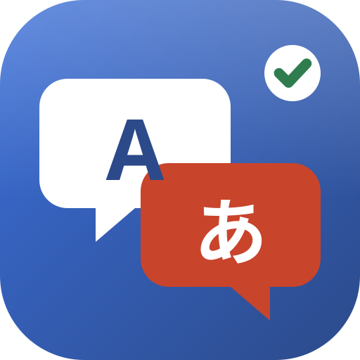
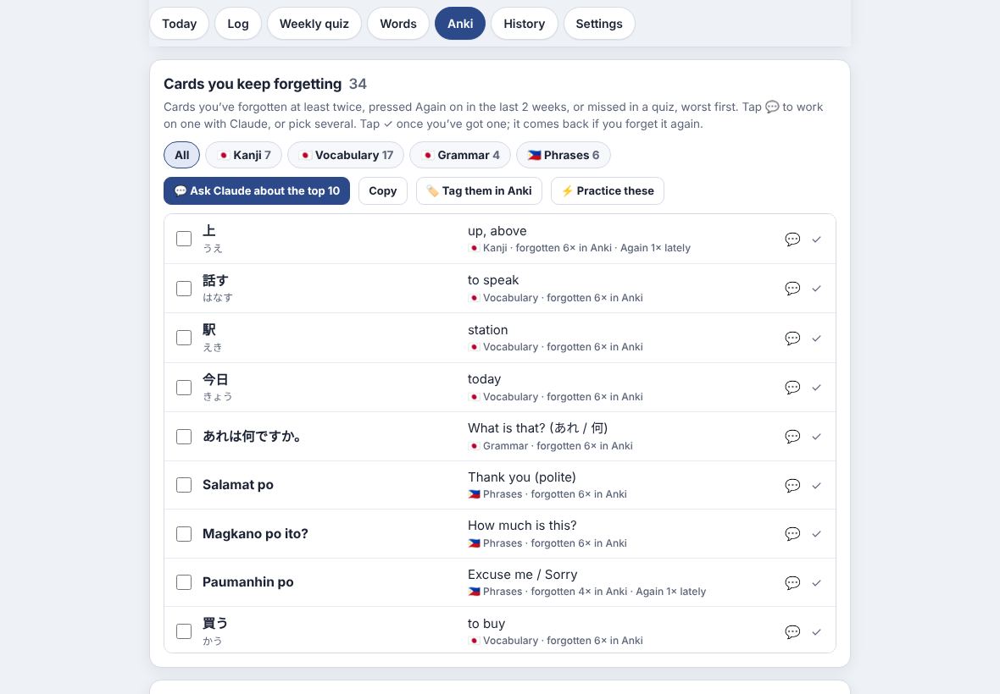

# A Better Language Tracker

**Study Log & Weekly Quizzes: track every language you're learning, sync with Anki, get quizzed on what you actually studied, and keep a journal with corrections**

**[▶ Open it online](https://seanwithanai.github.io/A-Better-Language-Tracker/)** · nothing to install · your data stays on your device

*by SeanwithanAI*

---

## Overview

A Better Language Tracker keeps your study log, goals, word lists and weekly quizzes for every language you're learning in one place. It syncs with Anki on your computer to track your progress automatically, finds the cards you keep forgetting, and has an AI chat (Claude, ChatGPT, Gemini or your own) write a weekly quiz from the cards you've actually learned. You can also keep a journal in the language you're learning: the AI corrects each entry, the tracker shows your mistakes in red with the fixes in green, and the mistakes you keep making come back in your quizzes until they stick. It's all in one HTML file, with nothing to install and no sign-up.

## Features

- **Any language.** Start from a preset (Japanese, Korean, Mandarin, Tagalog, Spanish, French, German, Italian, Portuguese, Russian, Vietnamese, Arabic, Hindi) or add your own. Each language has its own color, flag, level notes, counts, goal date and quiz mix. Right-to-left scripts display correctly.
- **Suggested Anki decks for every preset.** A starter deck, travel phrases and next steps for each language, picked from AnkiWeb ratings (thumbs up / down shown where known) and learner guides like Refold and TheMoeWay, with a link to each deck on AnkiWeb. Decks you already have are marked. Where no highly-rated deck exists, it says so.
- **Today at a glance.** Today's plan from your weekly schedule, a low-energy-day minimum, your day streak, days studied this week, and minutes against your weekly goal. Tap any day of the week to edit it.
- **Study log.** Minutes per language (with +10 / +30 buttons), what you did from your own list of activities, and a note. Go back and fix any day.
- **Counts and milestones.** Track words, kanji, characters, lessons or phrases. Give a count a milestone and a date, and see how many per week you need and whether you're on pace, based on your own updates.
- **Trip and goal countdowns** for each language.
- **Words & phrases.** Your own list with readings, meanings and notes. Add many at once by pasting lines like `word = meaning`. Searchable, with a quick quiz from the list.
- **Anki sync** (desktop Anki with the free [AnkiConnect](https://ankiweb.net/shared/info/2055492159) add-on):
  - **Finds your decks** and matches each to a language and skill: Core 6k → vocabulary, JLAB → grammar, KKLC → kanji, a Tagalog deck → phrases. Change any match, and which card fields hold the word, reading, meaning and example sentence.
  - **Counts update themselves** from the cards you've started (or matured) in each deck.
  - **Review time is logged** for each day automatically, separately from the minutes you type.
  - **This week in Anki:** reviews, retention, time and cards started for each deck.
  - **Syncs on its own** whenever the tracker is open on the computer with Anki, and every 10 minutes while it's open. Your phone shows the last sync.
- **Cards you keep forgetting.** Cards forgotten twice or more in Anki, pressed Again in the last two weeks, or missed in a quiz, worst first. For any of them:
  - 💬 ask your AI chat for memory tricks, example sentences and how to tell look-alikes apart, for one card or several at once;
  - ⚡ practice them in a quick quiz;
  - 🏷️ tag them in Anki to review just those in a filtered deck;
  - ✓ mark one as got it (it comes back if you forget it again).
- **Weekly quiz, written by an AI chat from what you've learned.** Works with a free Claude, ChatGPT or Gemini account, or any AI chat you paste into (pick it in **Settings → AI chat**):
  1. The tracker sends the AI a sample of the cards you've learned, each with an ID like `D1-13kw`, plus how you did on last week's quiz. Each quiz builds on the last one: about a third of the questions go back over cards you missed or keep forgetting, a few re-check cards you got right last time in a harder situation, and the rest cover new and other learned cards.
  2. The AI builds every question from those cards in new, everyday situations (ordering food, asking directions, a text from a friend), and tags each question with the cards it tests.
  3. Paste the reply back. The tracker checks every question against your cards and leaves out any that use cards you haven't learned.
  4. You get a score, a skill ranking with a focus for next week, and an explanation for every question. Any question you got wrong or skipped also shows an example sentence (with its meaning) using the right answer, so you can see how it's really used. Every card you missed goes on your forgetting list.
  5. **💬 Go over my mistakes** sends the questions you got wrong (and what you picked) to your AI chat, which explains them and quizzes you until you get each one right.
- **Every quiz builds on all the ones before it.** Each card keeps a record across every quiz and drill: how often you missed it, what you picked instead, and how many times in a row you've gotten it right since. Cards you keep missing come back (including a question against the answer you mixed it up with), cards you used to miss get re-checked in harder situations until they're right three times in a row, and cards you know come back now and then as review.
- **Study plan until your next quiz.** After your weekly quiz, your AI chat turns your quiz history into a short lesson, a memory tip and a 4–5 question drill for each day until the next quiz. What you keep missing comes back every couple of days in a different way. Each day's lesson and drill shows on the Today tab, with catch-up for days you missed, and every drill feeds into your next quiz and plan.
- **Journal with corrections.** Write an entry in the language you're learning, then your AI chat corrects it. Paste the reply back and the tracker shows your entry with what you got wrong underlined in red and the fixes in green. Below that are a numbered list of fixes (what you wrote → the fix, the rule, why, and an example sentence), feedback, what you got right, the corrected entry, a more natural version and the English meaning. Words worth learning can go straight to your word list, and **💬 Go over this** opens a tutoring session on that entry. Every entry is kept, and you can edit and check it again. Like the weekly quiz, every request can also be copied and pasted into any AI chat. Optional minutes spent count as study time.
- **Writing progress.** Entries, how much you've written, and mistakes per 100 characters (or words) over time. **What to work on** groups your mistakes by rule across all entries, shows which ones are still coming up and which have stopped, and has a **💬 Practice this** button for each. The mistakes still coming up go into your weekly quiz, study plan and check-in, and the next correction request reuses the same rule names so they're tracked consistently. **💡 Need an idea?** suggests a topic and a form you've had trouble with.
- **Daily practice.** Free, offline questions built from your learned cards: fill in the blank in your decks' example sentences, sentence meanings, and words in both directions. It rotates through all your decks.
- **Weekly check-in with your AI chat.** Sends your week's Anki numbers, study log, quiz results and toughest cards for a short review, what to change next week (like new cards per day), and memory tricks.
- **Time spent.** See how long you've studied each kind of thing (Anki, grammar & lessons, immersion, kanji, speaking and more) over the last week, month, 3 months, 6 months, year or all time, with Anki split by deck. Add minutes next to each activity on the Log tab; Anki time is added on its own, including your full review history from before you started the tracker.
- **History.** Quiz results by week, every past quiz and drill to review question by question (with how many things you used to miss are now learned), recent study days, and how each count has changed.
- **Charts.** Minutes per week for the last 8 weeks, stacked by language.
- **Day, Dark and Auto** themes.
- **Works on phones.**
- **Backup and restore,** with a reminder when you haven't backed up in a week (outside PageVault).
- **Download app + data.** In **Settings**, one click downloads a .zip with this version of the app, a backup of your data, and a short note on how to restore it. Open the HTML anywhere and restore the backup to pick up where you left off. In PageVault it's the exact file that's installed.

## Screenshots

| Weekly quiz | Daily practice |
|---|---|
|  |  |

| Cards you keep forgetting |
|---|
|  |

Screenshots use made-up example data.

## Getting started

1. Open `A-Better-Language-Tracker-<date>-<mk>.html` in any modern browser, or open it from **PageVault**.
2. Pick the languages you're studying. Change counts, goals and the quiz mix in **Settings**. The **Anki** tab suggests good free decks to start with.
3. **Anki (optional):** in Anki on your computer, go to **Tools → Add-ons → Get Add-ons…**, enter `2055492159` and restart Anki. Then open the tracker on that computer, go to the **Anki** tab, tap **Connect to Anki**, and choose **Yes** in Anki's pop-up.
4. Log your study on the **Log** tab, and take the **Weekly quiz** on your quiz day.
5. **Journal (optional):** write an entry on the **Journal** tab, tap the button to send it to your AI chat (or **Copy request** to paste it into any AI chat), then paste the reply back to see your corrections.

Anki sync only works on the computer where Anki is running. Everything else works offline.

If the tracker can't connect to Anki, open **Tools → Add-ons → AnkiConnect → Config** in Anki and add `"null"` to `webCorsOriginList`. That's how PageVault apps and downloaded pages identify themselves. Using the web link? Also add `"https://seanwithanai.github.io"`, and if your browser asks to allow access to devices on your local network, allow it (that's how it reaches Anki).

## Opening the file on your devices

**Easiest: the web link.** Open **[seanwithanai.github.io/A-Better-Language-Tracker](https://seanwithanai.github.io/A-Better-Language-Tracker/)** on any phone, tablet or computer. It's this same app, served by GitHub, and it always has the newest version. Nothing is sent anywhere: your data is saved in that browser on that device, just like the downloaded file. On iPhone or iPad, open it in Safari, tap **Share** (on iOS 26 and later, tap **•••** first), then **Add to Home Screen** to keep it like an app. On Android, use Chrome's **⋮ → Add to Home screen**.

Prefer to keep your own copy of the file? The steps below cover that.

The app is one self-contained `.html` file: no install, no account, nothing else to download. Download `A-Better-Language-Tracker-<date>.html`: open it in the file list above, then use the **Download raw file** button (↓) at the top right of the file view.

**Desktop (Windows, macOS, Linux)**
1. Download the file and move it somewhere permanent, like Documents.
2. Double-click it. It opens in your default browser (Chrome, Edge, Firefox, Safari and Brave all work).
3. Bookmark it, and always open it the same way: same file, same place, same browser. Your data is saved in that browser for that file, so a copy in another folder or another browser starts empty.

**iPhone and iPad**
**Because of iOS, an HTML file saved on your iPhone or iPad can't be opened in Safari.** iOS doesn't offer Safari as a way to open it, and tapping the file in the Files app only shows a preview with the buttons turned off. Use one of these instead:
- **The web link (recommended).** See above.
- **PageVault.** Open the app's PageVault link in **Safari**, then tap **Share** (on iOS 26, tap **•••** first, then **Share**). Scroll down the list and tap **Add to Home Screen**. If it isn't there, tap **Edit Actions** at the bottom of the list and add it. It then opens like a regular app, and your data is saved on your server and syncs with your other devices.
- **Microsoft Edge (may work).** Save the file to the Files app, then try opening it with Edge (in Files, open the file, tap **Share** and choose **Edge**). Keep backups: data saved this way can be lost if Edge clears its storage.

**Android**
1. Download the file in Chrome.
2. Open it from Chrome: **⋮ → Downloads** and tap the file (or from the Files app, **Open with → Chrome**).
3. Open it from Chrome's Downloads each time. A home-screen shortcut to a downloaded file may stop working after Chrome restarts.
4. Turn on backups (the app reminds you every 7 days), or use **PageVault** and **⋮ → Add to Home screen** so your data lives on your server instead.

**Moving to another device:** download a backup in the app, open the same version on the new device, and restore the backup there. With PageVault there's nothing to move.

## Where your data is stored

| Opened from… | Saved to | Status shown under the app's name |
|---|---|---|
| **PageVault** | Your own server only, separately for each signed-in person. Nothing is kept in the browser. No backup reminders. | *Saved to your server* |
| **A local file** | This browser only. Saved in the browser's large storage, with room for years of data; the app asks the browser to keep it rather than clear it to free up space. Use **Settings → Download backup** to keep a copy; a reminder appears after 7 days without one. | *Saved on this device only* |

The tracker never changes anything in Anki except the optional `tracker::forgetting` tag. Moving between the two: back up on one side and **Restore from backup** on the other.

## Versioning

Only the newest release is kept in the repo: `A-Better-Language-Tracker-2026-11-25.html`. Each new release replaces it, and `docs/index.html` (what the web link opens) is updated to match. Your data isn't stored in the file, so moving to a new release keeps it (if you use the downloaded file, open the new one the same way as before, in the same browser, and download a backup first to be safe).

Releases are named with their date. The first release of a day is just the date; later releases that same day add `mk1`, `mk2`, `mk3`… (the count starts over each day). The version is also shown inside the app.

### Changelog

Every release so far, newest first. Older releases are listed for reference; only the current one is available to download.

| Version | Notes |
|---|---|
| **2026-11-25** | **Backup reminders on phones.** The 7-day backup reminder is now checked again whenever the app comes back on screen, and every hour while it stays open. A tracker added to a phone's Home Screen is usually resumed instead of reloaded, so before this the reminder could be missed for weeks. |
| **2026-11-24** | **New Journal tab.** Write in any language you're learning, get corrections from your AI chat, and see what you got wrong underlined in red with the fixes in green, plus why, examples, a corrected and a more natural version, and words to add to your list. Every entry is logged. **Writing progress** shows mistakes per 100 characters or words over time and the rules you keep breaking, with practice for each. Those mistakes now feed into the weekly quiz, study plan and check-in. Journal minutes can count as study time (a new **Writing** activity type). Every journal request (corrections, going over an entry, practicing a mistake) can also be copied into any AI chat. |
| **2026-11-22 mk1** | **Quizzes build on your whole history.** Every quiz and drill is now kept (review any of them on the History tab), and each card keeps a record across all of them: times missed, what you picked instead, and how many times in a row you've gotten it right since. The weekly quiz uses that record to bring back what you keep missing, re-check what you used to miss until it sticks, and mix in what you know as review. **New study plan:** after your weekly quiz, your AI chat makes a short lesson and drill for each day until the next one, shown on the Today tab. **💬 Go over my mistakes** sends what you got wrong to your AI chat for a tutoring session. The weekly check-in now includes what you're still missing and how your drills went. |
| **2026-11-22** | **The weekly quiz builds on last week.** Along with the cards you missed or keep forgetting (about a third of the questions), it now re-checks a few cards you got right last time in a harder situation, and the AI sees how you did on each skill last week. **Example sentences for wrong answers:** every question you get wrong or skip shows a short example sentence using the right answer, with its meaning, under a fuller explanation. A quiz request made with an older version is rebuilt automatically. |
| **2026-11-19** | Fixes restoring a backup over existing data, which could freeze or crash the browser on iPhone (in Safari, Brave or Chrome). Every question and notice (restore, delete, discard, erase, naming a language or skill) now opens in the app's own panel instead of the browser's pop-up, and a backup that can't be read leaves your current data untouched. |
| **2026-11-16 mk4** | PageVault save status is accurate: a change on its way now shows **Saving to your server…** instead of briefly saying **Can't reach your server**, which only appears if a change still hasn't gone through after 10 seconds. |
| **2026-11-16 mk3** | **Room to grow.** Opened on its own, the app now keeps its data in the browser's large storage (IndexedDB) instead of the small save area (about 5 MB, shared with every page on the same site), so a big history never runs out of room. Your data moves over automatically the first time you open this version. The app asks the browser to keep its data, and says so plainly if the browser ever can't save. In PageVault nothing changes. (An older copy of the file opened afterwards won't see data saved by this version, so use this one or newer.) |
| **2026-11-16 mk2** | **Use it online.** The app now has a web link, [seanwithanai.github.io/A-Better-Language-Tracker](https://seanwithanai.github.io/A-Better-Language-Tracker/), that works on any device, including iPhone and iPad, and always has the newest version. The preview shown when the file can't run points to it. |
| **2026-11-16 mk1** | The preview now says plainly that, because of iOS, an HTML file saved on an iPhone or iPad can't be opened in Safari, and points to PageVault instead. |
| **2026-11-16** | **Pick your AI chat.** Quizzes, weekly check-ins and memory help can go to Claude, ChatGPT, Gemini or any other AI chat (Settings → AI chat; Claude stays the default). The preview shown when the file can't run now explains how to open it on each device. |
| **2026-11-14 mk5** | **Time spent** on the History tab: time by type (Anki, grammar & lessons, immersion, and more) for a week, month, 3 months, 6 months, year or all time. Optional minutes next to each activity on the Log tab (language totals fill in from them), a type for each activity in Settings, Anki time split by deck, and a deck's full review history brought in on its first sync. |
| **2026-11-14 mk4** | The browser tab and home-screen icon now use the app's logo. |
| **2026-11-14 mk3** | **Suggested Anki decks** for every preset language (starter, travel phrases, next step and advanced), with AnkiWeb ratings where known and links to each deck. On the Anki tab, in each language's settings, and on Today for new users. |
| **2026-11-14 mk2** | The weekly quiz request lists the cards you've learned with IDs; Claude builds questions from them in new situations, the tracker checks every pasted question against your cards, and missed cards go on your forgetting list. New **Daily practice** from your decks' example sentences. **Tag them in Anki** for a filtered deck. Better card-field matching, right-to-left text, Conjugation and Noun genders skills, and Russian, Vietnamese, Arabic and Hindi presets. |
| **2026-11-14 mk1** | **Anki sync** through AnkiConnect: finds and matches your decks, keeps counts up to date, logs review time, shows each deck's week, lists the cards you keep forgetting with Claude memory help and practice, a weekly check-in with Claude, and quizzes that aim at your trouble cards. |
| **2026-11-14** | First release. |

A Better Language Tracker · Study Log & Weekly Quizzes · by SeanwithanAI

